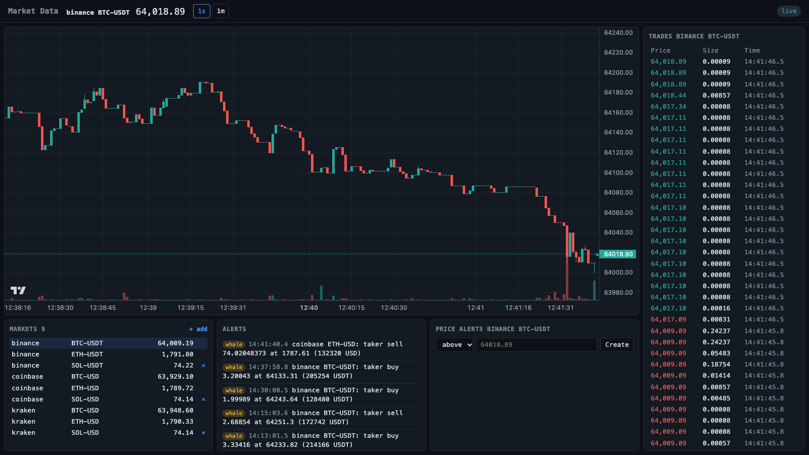
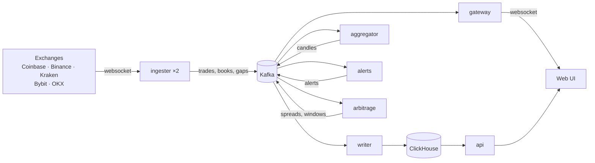

# marketdata

Real-time crypto market data platform in Go. It streams trades and order books from five
exchanges over their public websockets, normalizes them, and runs them through Kafka into
ClickHouse, live candles, alerts, cross-exchange arbitrage analysis and a websocket gateway
with a web UI.



## Features

- **Five exchanges, one model** — Coinbase, Binance, Kraken, Bybit and OKX trades and L2 order
  books, normalized to one format (`BTC-USDT` everywhere, taker side, exact decimals).
- **No data loss on deploys** — two redundant ingesters per feed, deduplicated downstream;
  trade-ID gap detection; order books verified by checksums or sequence numbers and resynced
  on divergence.
- **Storage** — ClickHouse with batched at-least-once writes, idempotent tables and retention.
- **Live candles** — 1s and 1m OHLCV with VWAP and taker buy/sell volume, built in event time;
  charts from 1s to 1d.
- **Alerts** — one-shot price alerts, whale trades (per-market thresholds) and sharp moves.
- **Arbitrage** — the same asset compared across exchanges in one currency (USDT/USDC converted
  at live rates), edge after taker fees, depth-aware size, history of opportunities.
- **Websocket gateway** — subscribe to trades, candles, books, alerts and arbitrage channels;
  scales horizontally.
- **Web UI** — candlestick chart, order book, trade tape, markets of all exchanges, add any pair
  an exchange trades at runtime, alerts and settings.
- **Observability** — Prometheus metrics on every service and a provisioned Grafana dashboard.

## Architecture



Every service is a small Go binary that talks to the others only through Kafka topics, so each
can be restarted, scaled or replaced on its own. State that must survive restarts (price alert
rules, subscribed markets, settings) lives in compacted Kafka topics rather than a separate
database.

| Service | What it does |
|---|---|
| `ingester` | Connects to the exchanges, normalizes trades and order books, publishes to Kafka. Runs as two identical replicas. |
| `writer` | Batches events from Kafka into ClickHouse; commits offsets only after a successful insert. |
| `aggregator` | Builds 1s/1m candles from trades in event time. |
| `alerts` | Evaluates price rules, whale trades and sharp moves; rules API. |
| `arbitrage` | Compares order books of one asset across exchanges; publishes spreads and opportunity windows. |
| `gateway` | Websocket server fanning out live data to clients. |
| `api` | Serves the web UI and history from ClickHouse; proxies the gateway and rules API. |

## Tech stack

Go · Kafka 4 (KRaft) · ClickHouse · Protobuf (buf) · Prometheus · Grafana ·
React 19 + TypeScript + Vite · TradingView Lightweight Charts · Docker Compose · GitHub Actions

Go libraries: franz-go (Kafka), clickhouse-go, coder/websocket, shopspring/decimal,
prometheus/client_golang.

## Getting started

Requirements: Docker with Compose (give Docker at least 4 GB of memory, 8 GB recommended) and
`make`. Go and Node are only needed for development outside Docker.

```sh
cp .env.example .env    # optional: every setting has a default
make up                 # builds the images and starts the whole stack
```

After about a minute:

| | URL |
|---|---|
| **Web UI** | http://localhost:8088 |
| Grafana (dashboard "Market Data Pipeline") | http://localhost:3000 |
| Kafka UI | http://localhost:8080 |
| Prometheus | http://localhost:9090 |

`make down` stops everything. To restart ingesters without losing trades, use
`make deploy-ingesters` (one replica at a time).

## API

**Websocket** — `ws://localhost:8090/ws` (also proxied at `ws://localhost:8088/ws`):

```json
{"op": "subscribe", "channels": ["trades:binance:BTC-USDT", "candles:coinbase:BTC-USD:1m"]}
```

| Channel | Data |
|---|---|
| `trades:<exchange>:<symbol>` | every trade |
| `candles:<exchange>:<symbol>:<1s\|1m>` | candles as they close |
| `book:<exchange>:<symbol>` | top 50 levels of the order book, ~10 per second |
| `alerts:<exchange>:<symbol>` | alerts of a market |
| `arb:<asset>` | cross-exchange comparison, e.g. `arb:BTC-USD` |

**REST** (`http://localhost:8088/api/...`): `markets`, `catalog`, `subscriptions`, `candles`,
`trades`, `alerts`, `rules`, `settings`, `arb/windows`, `arb/stats`.

```sh
# a one-shot price alert, delivered on the returned channel alerts:rule:<id>
curl -X POST localhost:8088/api/rules \
  -d '{"exchange":"binance","symbol":"BTC-USDT","direction":"above","price":"70000"}'
```

## Configuration

All configuration comes from environment variables; [`.env.example`](.env.example) lists every
one with its default and a short explanation (exchanges and default pairs, Kafka topics, batch
sizes, alert and arbitrage settings, …). Pairs beyond the defaults are added from the web UI at
runtime.

## Development

| Command | |
|---|---|
| `make test` | unit tests (with the race detector) |
| `make test-integration` | ClickHouse tests against a running instance (`make up`) |
| `make lint` | gofmt, go vet, buf lint |
| `make vuln` | govulncheck |
| `make proto` | regenerate Go code from `proto/` |
| `make frontend-dev` | web UI with hot reload against the running stack |
| `make dashboard` | regenerate the Grafana dashboard |
| `make bench`, `make bench-pipeline`, `make load` | micro-benchmarks, pipeline replay benchmark, websocket load test |

CI runs lint, unit and integration tests, govulncheck, the frontend checks and the image build
on every pull request.

## Project layout

```
cmd/                    one directory per service (+ loadgen, replay tools)
internal/exchange/*     exchange adapters, tested on captured real frames
internal/ingest         websocket connection lifecycle: dial, subscribe, reconnect
internal/book           L2 order book engine
internal/candles        candle aggregation
internal/alerts         rules index and detectors
internal/arb            cross-exchange arbitrage engine
internal/gateway        websocket fan-out
internal/writer, store  Kafka → ClickHouse, history queries
internal/model, codec   normalized events and their protobuf encoding
proto/                  event schemas
migrations/clickhouse/  ClickHouse schema
frontend/               web UI (React + TypeScript)
deploy/                 Prometheus and Grafana provisioning
```

## Design notes

- **Exact numbers.** Prices and sizes are decimals end to end (strings on the wire), never floats.
- **At-least-once, then deduplicate.** Kafka offsets are committed only after data is stored or
  derived results are published; replays are absorbed by deterministic IDs and ReplacingMergeTree
  tables.
- **Redundant ingesters.** Two replicas stream the same feeds; consumers keep a bounded window of
  recent trade IDs and drop the copies, so one replica can be restarted at any time.
- **Event time.** Candles close on a per-market watermark with allowed lateness, not on the wall
  clock, so they come out the same when history is replayed.
- **Exchange quirks are handled in adapters.** For example: Coinbase reports the maker side,
  OKX aggregates trades per price level, Bybit trade IDs are not sequential per market, Kraken
  books carry a CRC32 checksum. Each adapter is tested on frames captured from the live API.

## Limitations

- A demo setup: the rules, subscriptions and settings APIs have no authentication.
- Both ingester replicas run on one machine here; in production they belong on different hosts.
- Arbitrage uses static taker fees and assumes pre-funded accounts on both exchanges (no
  transfer costs or delays).
